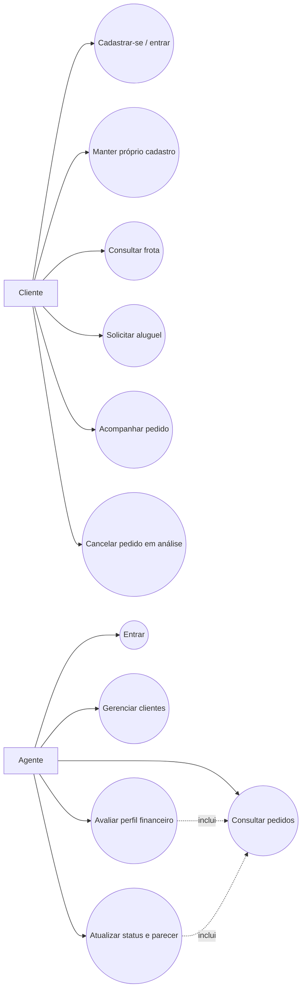
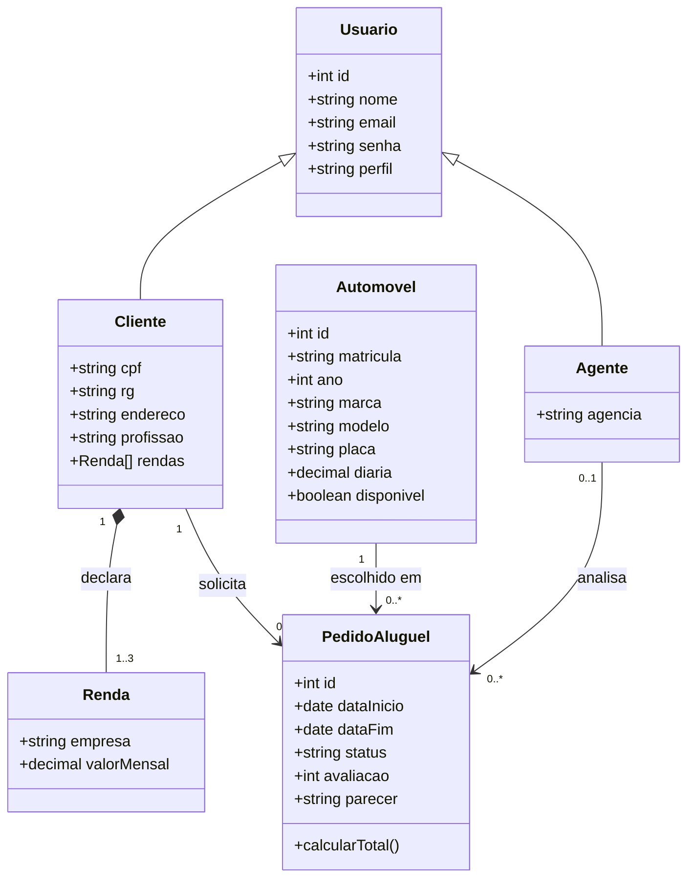
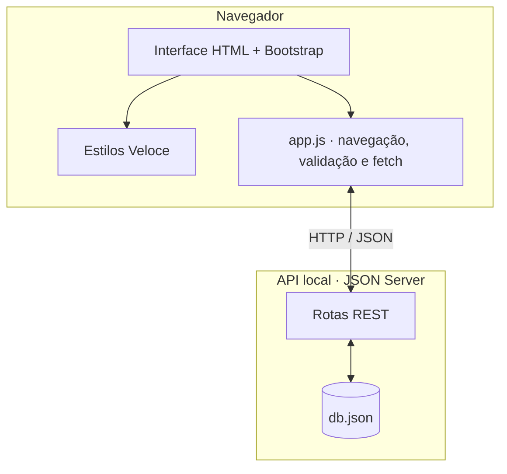
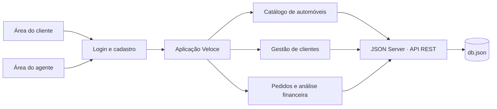

# 🚘 Veloce — Aluguel de Carros

Protótipo acadêmico de uma experiência web para cadastro de clientes, solicitação de aluguel de veículos e análise financeira de pedidos por agentes.

> **Identidade visual:** Onyx `#202427` e Tropical Teal `#05A9AA` são as cores principais. Alice Blue `#EEF7F8` e Lilac Ash `#C4C0CD` aparecem em detalhes. Flag Red fica restrito às inscrições da roda na logo enviada.

## 🚧 Status do projeto

  

Protótipo acadêmico para execução local. A autenticação é simulada no navegador e os dados usam uma API local de desenvolvimento; não utilize informações pessoais reais.

## 📚 Índice

- [Sobre o projeto](#-sobre-o-projeto)
- [Funcionalidades principais](#-funcionalidades-principais)
- [Tecnologias](#-tecnologias-utilizadas)
- [Arquitetura e modelagem](#-arquitetura-e-modelagem)
- [Instalação e execução](#-instalação-e-execução)
- [Estrutura de pastas](#-estrutura-de-pastas)
- [Demonstração](#-demonstração-local)
- [Documentação utilizada](#-documentação-utilizada)
- [Autoria e agradecimentos](#-autoria-e-agradecimentos)

## 📝 Sobre o projeto

A Veloce organiza o processo de aluguel em duas áreas conectadas: o cliente mantém seus dados e acompanha solicitações; os agentes consultam cadastros, avaliam informações financeiras e atualizam o parecer e a situação do pedido. A aplicação foi construída como protótipo de interface e persistência para o Laboratório 02 de Desenvolvimento de Interfaces Web.

## ✨ Funcionalidades principais

- Cadastro e login de clientes; contas de agente de demonstração.
- Edição dos dados pessoais, documentos, endereço, profissão e até três rendas por cliente no modelo de dados.
- CRUD de clientes na área do agente.
- Catálogo da frota com pesquisa e filtro por categoria.
- Criação, leitura e cancelamento de pedidos de aluguel, com cálculo do valor estimado por diária.
- Consulta do histórico e do status do pedido pelo cliente.
- Área do agente para consultar pedidos, registrar avaliação financeira de 1 a 5 estrelas, escrever parecer e encaminhar o pedido para análise, consideração, aprovação, recusa ou execução de contrato.
- Persistência de dados por API REST simulada com JSON Server.
- Interface responsiva com Bootstrap 5 e identidade visual Veloce; a frota apresenta as quatro fotos fornecidas.

## 🛠 Tecnologias utilizadas

- **Front-end:** HTML5, CSS3, JavaScript ES6+, Bootstrap 5.3.
- **API e persistência de demonstração:** JSON Server 0.17 e arquivo `db.json`.
- **Execução local:** Node.js e npm; `http-server` e `concurrently`.
- **Modelagem:** diagramas Mermaid de casos de uso, classes, pacotes e componentes; histórias de usuário neste documento.

## 🏗 Arquitetura e modelagem

A interface é uma aplicação de página única sem etapa de build. O `app.js` controla autenticação de demonstração, estado de navegação, renderização, formulários e chamadas `fetch`. O JSON Server expõe as coleções de `db.json` como endpoints REST e grava operações no arquivo. O navegador acessa o site na porta `8080` e a API na porta `3000`.

### Histórias de usuário

- **Cliente:** como cliente cadastrado, quero informar meus documentos, endereço, profissão e fontes de renda para solicitar um aluguel com meus dados disponíveis para análise.
- **Cliente:** como cliente, quero consultar veículos, selecionar um período, enviar e acompanhar o status do pedido.
- **Cliente:** como cliente, quero corrigir meu cadastro e cancelar um pedido que ainda está em análise.
- **Agente:** como agente, quero consultar e manter os cadastros dos clientes para apoiar a análise.
- **Agente:** como agente, quero consultar o valor do aluguel e as rendas declaradas para registrar avaliação e parecer financeiro.
- **Agente:** como agente, quero atualizar o pedido para que o cliente acompanhe a decisão e a etapa do contrato.

### Casos de uso



### Diagrama de classes



### Diagrama de pacotes



### Diagrama de componentes



### Modelo de dados

`Usuario` tem um perfil (`client` ou `agent`). Clientes armazenam identificação, endereço, profissão e um vetor `incomes` com até três empresas e rendas mensais. Agentes armazenam a agência. `PedidoAluguel` referencia cliente, automóvel e, após atribuição, agente; mantém período, status, avaliação, parecer e data de criação. `Automovel` guarda matrícula, ano, marca, modelo, placa e diária. As coleções `companies` e `banks` ficam disponíveis em `db.json` para evolução do protótipo.

## 🔧 Instalação e execução

### Pré-requisitos

- Node.js LTS e npm.
- Navegador atualizado.
- Acesso à internet para carregar Bootstrap, Bootstrap Icons e fontes CDN.

### Executar localmente

Abra um terminal nesta pasta do projeto e rode:

```bash
npm install
npm run dev
```

A interface abre em `http://localhost:8080` e a API em `http://localhost:3000`. Se o navegador não abrir sozinho, acesse o endereço da interface manualmente. O JSON Server persiste as alterações em `db.json`; faça uma cópia desse arquivo antes de limpar ou reiniciar os dados.

### Contas para demonstração

| Perfil | E-mail | Senha |
|---|---|---|
| Cliente | `marina@veloce.com` | `123456` |
| Cliente | `rafael@veloce.com` | `123456` |
| Agente | `ana@veloce.com` | `123456` |
| Agente | `bruno@veloce.com` | `123456` |

O cadastro público cria somente clientes. Para testar a área de agente, use uma conta de demonstração.

## 📂 Estrutura de pastas

```text
veloce-aluguel/
├── assets/
│   ├── logo-veloce.png       # Logo fornecida
│   ├── volvo-xc40.png        # Volvo
│   ├── bmw-320i.png          # BMW
│   ├── jeep-compass.png      # Jeep
│   └── mini-cooper.png       # Mini Cooper
├── docs/
│   └── modelos.md            # Referência aos modelos UML
├── app.js                    # Interface, navegação e integração REST
├── db.json                   # Dados iniciais do JSON Server
├── index.html                # Aplicação web
├── package.json              # Scripts e dependências locais
├── README.md                 # Documentação do projeto
└── styles.css                # Estilos responsivos e paleta Veloce
```

## 🖥️ Demonstração local

1. Acesse a página de login e entre como cliente ou agente.
2. Como cliente, explore a frota, crie um pedido e acompanhe o status em **Meus pedidos**.
3. Como agente, edite cadastros em **Clientes** e atualize parecer, avaliação e status em **Pedidos de aluguel**.
4. Atualize a página: as alterações permanecem salvas no `db.json` pelo JSON Server.

## 📖 Documentação utilizada

- [Template README recomendado na atividade](https://github.com/joaopauloaramuni/desenvolvimento-de-interfaces-web/blob/main/TEMPLATES/template_README.md)
- [Bootstrap 5](https://getbootstrap.com/docs/5.3/)
- [JSON Server](https://github.com/typicode/json-server)
- [Fetch API — MDN](https://developer.mozilla.org/docs/Web/API/Fetch_API)
- [Mermaid](https://mermaid.js.org/)

## 👩‍💻 Autoria e agradecimentos

Projeto desenvolvido para o Laboratório 02 da disciplina Desenvolvimento de Interfaces Web. Identidade visual e logo fornecidas pela pessoa solicitante; requisitos baseados no enunciado da atividade.


